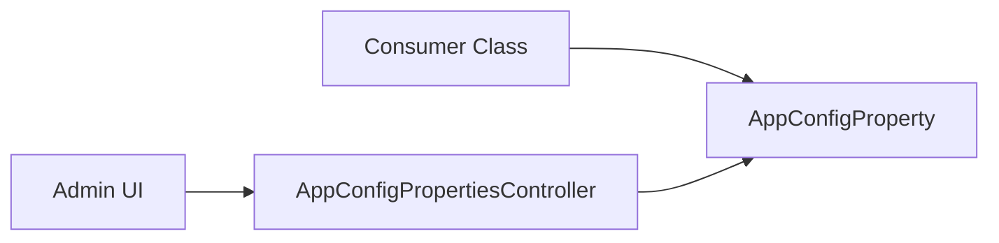

---
sources:
  - app/models/app_config_property.rb
  - app/controllers/admin/app_config_properties_controller.rb
  - app/models/soft_delete_retention_configuration.rb
  - app/models/grda_warehouse/config.rb
  - app/controllers/admin/configs_controller.rb
---

# App Config Property

App Config Property provides a key-value store for application-level configurations managed through the database. This system provides a database-backed alternative to environment variables for management by developers and support staff.

## Use Cases

The property store supports several configuration patterns:

- **Feature Flags**: Enabling or disabling specific modules or UI components (e.g., `hopwa_caper/atc_tab_enabled`).
- **External Integration Settings**: Storing service URLs or configuration keys for external APIs (e.g., `external_forms/presign_url`).
- **Business Logic Toggles**: Modifying application behavior without code changes (e.g., `hmis_external_apis/legacy_referrals/keep_source_enrollment_open`).
- **Operational Controls**: Managing background tasks or system maintenance processes (e.g., `purge_soft_deleted_records`).
- **Metadata Mapping**: Defining custom field names or identifiers used across different modules.

## Relationship to Site Configuration

`GrdaWarehouse::Config` is the other settings home: one row with a typed column per setting, edited on the Site Configuration admin page and versioned with paper trail. Prefer it for known, installation-wide settings. Adding one has several silent failure modes:

- Add the column with a database default that preserves current behavior, and append it to `known_configs`. That array is the strong-parameters permit list, so a setting missing from it is accepted by the form and discarded without error. Array-valued settings are listed as `name: []`.
- Restart the web process after the migration; a running process caches the column list and silently drops the new column from updates.
- `GrdaWarehouse::Config.get(:key)` memoizes the row for 30 seconds per process. A spec that changes a setting must call `GrdaWarehouse::Config.invalidate_cache`.

## Architecture

- `AppConfigProperty`: ActiveRecord model representing a single configuration entry.
- `Admin::AppConfigPropertiesController`: Controller for administrative CRUD operations on configuration properties.

## Integration

Configurations are accessed by querying the `AppConfigProperty` table. Usage patterns typically include:

- Scoping keys with prefixes (e.g., `feature_name/property_name`).
- Reading the value as stored. The `value` column is `jsonb`, so a number or boolean comes back typed and consumers don't cast. In the admin form, `"5"` is a string and `5` is an integer.

There is no read cache and no paper trail on this table. Each `find_by` is a query, so a configuration class that loads its prefix once (such as `Hmis::Ce::Configuration` or `SoftDeleteRetentionConfiguration`) is fine per request or job but wrong for a long-lived object.

Use this store for settings that have no natural model and don't justify a `GrdaWarehouse::Config` column. Don't read `ENV` for a per-installation setting.

## Example

The `HopwaCaper` module uses this feature to manage feature flags and field identifiers.

