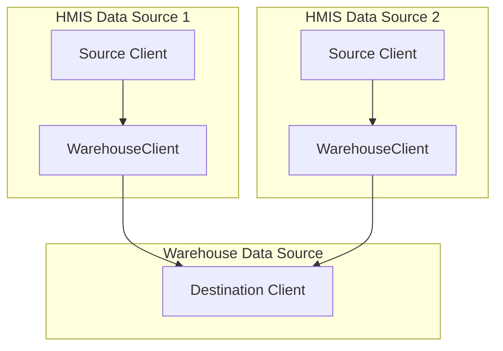

---
sources:
  - app/models/grda_warehouse/tasks/identify_duplicates.rb
  - app/models/grda_warehouse/tasks/identify_duplicates_query_matcher.rb
  - app/models/grda_warehouse/client_match.rb
  - app/models/grda_warehouse/tasks/client_cleanup.rb
  - app/models/grda_warehouse/dob_selector.rb
  - app/jobs/client_cleanup_job.rb
  - app/models/grda_warehouse/warehouse_client.rb
  - app/jobs/importing/run_daily_imports_job.rb
  - drivers/hmis/app/models/hmis/hud/client.rb
---

# Duplicate Client Identification

`GrdaWarehouse::Tasks::IdentifyDuplicates` links each source client record to one destination client that represents the person across data sources. It also merges destination clients that turn out to be the same person. This doc covers exact matching, merges and splits, and how `GrdaWarehouse::Tasks::ClientCleanup` maintains destination clients. It covers statistical `ClientMatch` candidates only where they touch exact matching. Merging clients inside the HMIS app is covered in [HMIS Client Merges](../hmis/hmis-client-merges.md).

## Source clients, destination clients, and the link between them

Every `GrdaWarehouse::Hud::Client` row is either a source client or a destination client:

- A **source client** is a record imported from, or entered in, an HMIS data source. Enrollments hang off source clients by `PersonalID` plus `data_source_id`.
- A **destination client** lives in the warehouse destination data source and represents one person.
- A **`GrdaWarehouse::WarehouseClient`** row links one source client (`source_id`) to its destination (`destination_id`).

A source client with no `WarehouseClient` row is **unprocessed**. `identify_duplicates` links each unprocessed source client to a destination. `match_existing!` merges destinations that are already linked, which catches duplicates that appear after linking. For example, a record entered with no SSN and a mistyped DOB gets its own destination. Once the DOB is corrected, it [matches](#how-a-match-is-decided) the person's other destination, and `match_existing!` merges the two.

Pitfalls when querying:

- A `Hud::Client` id in a URL, cohort, or report is a destination id.
- `Hud::Client.where(...)` with no `.source` or `.destination` scope returns both kinds of row. Go from a destination to HUD data through `source_clients`, and from a source to the person through `destination_client`.
- `WarehouseClient` does not use `acts_as_paranoid`. Its `deleted_at` is set by `ClientCleanup`: a run that finds destinations with no live source client left clears it on every row, then sets it on those destinations' links. A run that finds none leaves `deleted_at` alone, so `deleted_at` is not a reliable sign that a link is live. `ClientCleanup` maintains the column because OP Analytics tooling reads it.

## When deduplication runs

| Trigger | What runs |
|---|---|
| `Importing::RunDailyImportsJob` | `run!`, then `match_existing!`, then `ClientMatch.auto_process!` |
| End of each HMIS CSV import (`HmisCsvImporter::Importer::Importer#post_process`) | `run!` |
| `HmisSimulation::WarehouseSyncer` | `run!`, then `match_existing!` |
| HMIS client created | `ensure_source_client_linked!` for that client, on the short-running queue |
| HMIS client's `FirstName`, `LastName`, `DOB`, `SSN`, or `DateDeleted` updated | `match_existing!` on the long-running queue, unless one is already queued |
| `Hmis::Hud::Client.warehouse_identify_duplicate_clients` (fake enrollment generation, MCI imports) | `enqueue_full_run!`, which queues a full `run!` unless one is already queued |
| `Hmis::UndoMergeClientsJob` | a full `run!`, inline |
| `Importing::RunIdentifyDuplicatesJob`, rake tasks | `run!` |

The HMIS create hook is an `after_commit`, not an `after_create`. The job queue is in a different database, so the client row has to be committed before the job can find it.

The HMIS callbacks fire only on saves through the model. `update_columns`, `update_all`, and raw SQL skip them. After correcting a client's PII at the console, queue `match_existing!` yourself. The daily job will also catch it that night.

`Hmis::Hud::Client` recomputes `source_hash` on every save. That hash is the change detector for the warehouse import (see [HMIS CSV Importer](hmis-csv-importer.md)), not a dedup trigger.

In `RunDailyImportsJob`, deduplication runs before `ClientCleanup` and service history generation, so a merge made tonight is reflected in tonight's service history. Statistical candidates are generated near the end of the job, after `ClientMatch.auto_process!` has run, so new candidates aren't auto-accepted or auto-rejected until the next night.

## How a match is decided

Two clients match when at least **2 of 3** normalized fields match exactly:

| Field | Rules |
|---|---|
| SSN | Must pass `HudHelper.util.valid_social?`. Blanks and known placeholder values are excluded. |
| Name | First and last name, unaccented, lowercased, with non-alphanumeric characters stripped. Both parts must be present. |
| DOB | Present, with a year after 1920. |

What is compared differs between the two operations:

- **Linking** (`_for_unprocessed` queries) compares the unprocessed source client with the destination client row's own columns.
- **Merging** (`match_existing!`) compares the source clients of two destinations.

All matching runs as SQL queries that return id pairs, so client records are never loaded into Ruby to be compared.

### Two config keys with different meanings

- `enable_auto_deduplication` turns exact matching on or off. When it is off, every unlinked source client gets its own new destination, and `match_existing!` and `ClientMatch.accept_exact_matches!` return early.
- `auto_de_duplication_enabled` only governs threshold-based auto-accept and auto-reject of statistical `ClientMatch` rows.

### Hidden clients still match

Source clients hidden from interactive lookups (identities restricted in HMIS or the warehouse, or identities with a retention mark) are not filtered by the `IdentifyDuplicates` or `ClientMatch` paths, so hidden clients still match and merge.

### Which SQL runs

Each field has two query methods:

| Method | Returns | Used by |
|---|---|---|
| `exact_ssn_matches`, `exact_name_matches`, `exact_dob_matches` | `[destination_id, destination_id]` pairs | `match_existing!` |
| `exact_*_matches_for_unprocessed` | `[destination_id, source_id]` pairs | `identify_duplicates`, `ensure_source_client_linked!` |

Each method has legacy SQL and an `IdentifyDuplicatesQueryMatcher` implementation. A filter has to be changed in both until the legacy methods are removed.

The legacy existing-match queries self-join source clients. Their cost grows with the square of the number of rows that share a value, so they can hit the statement timeout at large installations. `IdentifyDuplicatesQueryMatcher` first groups rows into arrays of destination ids, then returns the same pairs.

`match_existing!` uses the matcher only when the `AppConfigProperty` row `identify_duplicates/use_query_matcher_for_existing_matches` holds the JSON boolean `true`. Any other value, including the string `"true"`, keeps the legacy SQL. A change applies on the next run. To switch back to legacy, delete the row. The admin form can't save `false`, because `AppConfigProperty` requires `value` to be present. See [App Config Property](app-config-property.md).

The `_for_unprocessed` methods always use the legacy SQL. The matcher's unprocessed query aggregates the whole destination table and is not used in production.

## Linking new source clients

`identify_duplicates` (called by `run!`) runs these steps:

1. Restores soft-deleted destination clients that are still referenced by a source client's `WarehouseClient` row, and forces a full service history rebuild for each.
2. Snapshots the ids of unprocessed source clients. A source client created during the run is left for the next run.
3. Runs the `_for_unprocessed` match queries and pairs each unprocessed source with at most one destination. When several destinations qualify, the one with the highest id wins.
4. In batches (`find_in_batches`), links each matched source to its destination. If the destination has no SSN, DOB, `FirstName`, or `LastName`, it takes the source's value. Each unmatched source is copied into a new destination. Destination updates, new destinations, and `WarehouseClient` rows are written with bulk imports.
5. Marks the touched destinations dirty for Coordinated Entry (`Hmis::Ce::ChangeMarker`) and invalidates service history for matched destinations.
6. Calls `ClientMatch.accept_exact_matches!`, which ends by running `ServiceHistory::Add` inline, then writes an `IdentifyDuplicatesLog` row.

Step 1 and `ClientCleanup` handle opposite failures in the same link. Step 1 restores destinations that are soft-deleted but still referenced. `ClientCleanup` soft-deletes destinations with no remaining source clients. A destination can meet only one of those conditions at a time.

`ClientSplitHistory` does not apply here. A new source that exactly matches two destinations that were split from each other is attached to the one with the higher id. A reviewer can split it again.

### One client at a time

`ensure_source_client_linked!(source_client_id)` is the per-client version of the same process:

- It returns without changes if the client is missing, soft-deleted, not a source, or already linked.
- It runs the same `_for_unprocessed` queries, restricted to this source and to destinations that share its valid SSN or its DOB. Every 2-of-3 match shares one of those, so this skips the scan of every destination.
- It links or creates a destination the same way the batch path does. It then writes an `IdentifyDuplicatesLog` row with `to_match: 1` and queues `ServiceHistory::Add.queue_clients` for the destination on the long-running queue.
- It does not restore deleted destinations or call `accept_exact_matches!`. The next full run handles those.

## Merging existing destinations

`match_existing!` runs these steps:

1. Returns if `enable_auto_deduplication` is off.
2. Collects destination pairs that match on at least 2 of 3 fields, and drops any pair that has a `ClientSplitHistory` row.
3. Groups the pairs into chains (`group_merge_chains`), each merged into a root destination. Chains are transitive, so A, B, and C can merge in one run even if A and C were never paired directly. Depending on id order, a member can be left out of the chain and merge on the next run instead.
4. Checks each chain against `MAX_SOURCE_CLIENTS`, which keeps any one destination from collecting too many source clients. Outside production, a chain over the limit is split.
5. In slices of 500 chains, calls `merge_from` for each pair with `cleanup: false`. It skips a destination that a concurrent merge has left with no source clients. A merge that raises is reported to Sentry and skipped, so one bad pair does not stop the run.
6. After each slice, queues `ClientCleanupJob` for the slice's clients and marks the root destinations dirty for Coordinated Entry.
7. When `run_post_processing` is true (the default), runs `ServiceHistory::Add` inline at the end.

## Merge and split

Use `merge_from` and `split` rather than editing links by hand.

`destination.merge_from(other)` moves the other client's source clients (or the other source client itself) to the receiver and records who reviewed it. It moves dependent items, forces a full service history rebuild for both destinations, and deletes `processed_sources` and `candidate` `ClientMatch` rows for every moved source. When the old destination has no source clients left, `merge_from` writes a `ClientMergeHistory` row and destroys it. It queues `ClientCleanupJob` unless called with `cleanup: false`.

- `merge_from` raises unless the receiver is a destination. `destination?` means "has source clients".
- A warehouse restriction on the old destination carries to the receiver. Restricting a receiver outside a destination data source raises and rolls back the merge.
- An external-data-sharing exclusion carries to the receiver only when the old destination is destroyed.
- Don't hand-roll a merge with `update_all(destination_id:)` or by deleting a destination. That skips the history, dependent items, service history, and `ClientMatch` cleanup.

`split` detaches source clients from a destination. It creates a new destination for each one, plus a `ClientSplitHistory` row and a new `WarehouseClient` row.

- A split is not an undo of a merge. It does not read `ClientMergeHistory`, does not restore the destroyed destination, and creates new destination ids.
- Only one detached client can receive notes, files, VI-SPDATs, cohort memberships, CE assessments, custom data elements, and other dependent items. Everything else stays with the original.
- Don't detach a source by deleting its `WarehouseClient`. That makes the source unprocessed, and the next `run!` re-links it to a matching destination, usually the one it left. `run!` ignores `ClientSplitHistory`, so it re-links even when a split-history row exists.
- The original destination's warehouse restriction and external-data-sharing exclusion carry to every new destination.
- `ClientSplitHistory` only blocks `match_existing!`. See [Linking new source clients](#linking-new-source-clients) for how a new source is matched against split destinations.
- `splits_to` and `splits_from` on `Hud::Client` are named inversely to their foreign keys (`split_from` and `split_into`). Read the `foreign_key` before using either.

## How destination attributes are chosen

Destination demographics (name, SSN, DOB, race, gender, sex, veteran status) are set by `ClientCleanup` from the destination's source clients, not by imports. Views read the destination's columns rather than choosing a name or DOB from `source_clients`; `GrdaWarehouse::SourceClientNameSet` lists a client's source names as aliases.

`ClientCleanup#choose_attributes_from_sources` applies these rules:

- **Name:** the best `NameDataQuality` tier (1, 2, 8, 9, 99), then the earliest or latest `DateCreated` per the `warehouse_client_name_order` config (default earliest).
- **DOB:** with `dob_selection_method` set, `GrdaWarehouse::DOBSelector` picks by `DOBDataQuality` first, then by the oldest or newest source record (`DateCreated`). It never picks by the earliest or latest birth date. If it isn't set, the legacy data-quality tier walk applies. A DOB change invalidates service history.
- **Gender and race:** per column, newest source first by `DateUpdated`, and a 0 or 1 wins.

Because each field is chosen independently, a destination's demographics can combine values from several sources and may not match any single source record.

`Hmis::MergeClientsJob` reuses `choose_attributes_from_sources`, so changing a `choose_best_*` rule changes HMIS merge results too. That job and `Hmis::UndoMergeClientsJob` change `WarehouseClient` rows directly:

- `UndoMergeClientsJob` runs `IdentifyDuplicates#run!` inline to re-link sources.
- `MergeClientsJob` calls `ensure_source_client_linked!` when it carries a warehouse restriction to a retained client that is not linked yet.
- Both rely on the next `ClientCleanup` run to recompute destination attributes.

## Statistical candidates (`ClientMatch`)

Statistical candidate generation creates `ClientMatch` rows for reviewers. The rows also interact with exact matching:

- Both sides of a `candidate` row are source clients, despite the `source_client` and `destination_client` column names. Code that needs the person calls `.destination_client` on each side.
- `processed_sources` rows are bookkeeping that mark a destination as scanned. Both ids are the destination's id. A count of `ClientMatch` rows without a status scope such as `candidate` overstates the candidates.
- `ClientMatch#accept!` merges only the match's one source client into the other side's current destination, so a single `WarehouseClient` row moves.
- `ClientMatch.accept_exact_matches!` accepts any `candidate` whose two clients match on 2 of 3 fields, and deletes candidates whose clients no longer exist. Its comparison is looser than the SQL matching: names are compared exactly as stored, without the normalization above, and DOB has no 1920 floor. It runs `ServiceHistory::Add` inline when it finishes.

## Concurrency

- `run!` and `ensure_source_client_linked!` share the `identify_duplicates` advisory lock and wait up to `PER_CLIENT_LOCK_TIMEOUT_SECONDS` for it. If it is still held, they call `enqueue_full_run!`, which queues a full `run!` unless one is already queued. A run that overlaps another is deferred, not dropped.
- `match_existing!` takes no lock. Because of that, it checks `destination?` before each merge.
- `ClientCleanupJob` re-queues itself a minute out when another `ClientCleanupJob` is running, so one runs at a time.

## Related

- [HMIS Client Merges](../hmis/hmis-client-merges.md): merging and unmerging clients in the HMIS app, and how those jobs call into this one.
- [HMIS CSV Importer](hmis-csv-importer.md): the import that runs `run!` in its post-processing and uses `source_hash` to detect changed clients.
- [PII and Restricted Clients](pii-and-restricted-clients.md): the hidden and restricted clients that are filtered from lookups but still matched.
- [Client ROI and Consent](client-roi-and-consent.md): how consent dates follow a source client to its new destination the night after a merge.
- [App Config Property](app-config-property.md): the key-value store that holds the query-matcher flag.
- [Warehouse building blocks](../../architecture/05-building-blocks/05-2-1-warehouse.md) and [Risks, R-2](../../architecture/11-risks.md): where deduplication sits in the warehouse, and the accuracy risk it carries.
