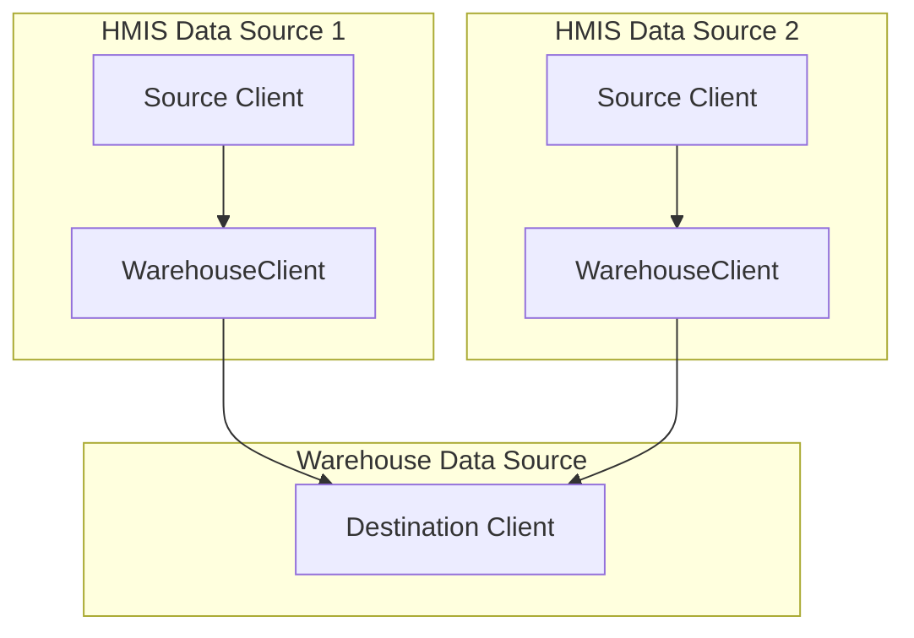

---
sources:
  - app/models/grda_warehouse/tasks/identify_duplicates.rb
  - app/models/grda_warehouse/tasks/identify_duplicates_query_matcher.rb
  - app/models/grda_warehouse/client_match.rb
  - app/models/grda_warehouse/tasks/client_cleanup.rb
  - app/models/grda_warehouse/warehouse_client.rb
  - app/jobs/importing/run_daily_imports_job.rb
---

# Duplicate Client Identification Algorithm

The `IdentifyDuplicates` deduplicates client records by identifying and linking clients that represent the same person across different data sources.

## Architecture Overview

The system operates on a **source-destination architecture**:
- **Source clients**: Original client records from HMIS data sources
- **Destination clients**: Deduplicated warehouse records (stored in destination data source)
- **WarehouseClient**: Junction table linking source clients to their destination client

### Key Models
- **`GrdaWarehouse::Hud::Client`**: Source and destination client records
- **`GrdaWarehouse::WarehouseClient`**: Links source to destination clients
- **`GrdaWarehouse::ClientMatch`**: Tracks candidate matches for review
- **`GrdaWarehouse::ClientSplitHistory`**: Prevents re-merging manually split clients
- **`GrdaWarehouse::IdentifyDuplicatesLog`**: Tracks algorithm execution statistics

### Data Flow

## Understanding "Unprocessed" vs "Processed"

**Unprocessed Clients**: Source clients without a `WarehouseClient` record (newly imported, not yet linked to a destination)

**Processed Clients**: Source clients with an existing `WarehouseClient` record linking them to a destination

This distinction is fundamental because:
- `identify_duplicates` processes unprocessed sources → links them to destinations
- `match_existing!` merges already-processed destinations → consolidates duplicates

### Matching Method Variants

Each matching criterion has two implementations with different return types:

| Method | Returns | Used By | Compares |
|--------|---------|---------|----------|
| `exact_ssn_matches` | `[dest_id, dest_id]` | `match_existing!` | destination ↔ destination |
| `exact_ssn_matches_for_unprocessed` | `[dest_id, source_id]` | `identify_duplicates` | destination ↔ unprocessed source |

Similar method pairs exist for name and DOB matching. The different return types reflect different architectural needs: linking new clients vs merging existing ones.

## Main Operations

The system provides three operations that handle different deduplication scenarios:

### Operation 1: `identify_duplicates` - Process New/Unprocessed Clients

**Purpose**: Handles newly imported or created clients that need to be linked to existing destinations or have new destinations created

**When `identify_duplicates` runs**:
- Automatically when new clients are created
- During data imports
- Via manual execution
- As part of the daily processing script

**What `identify_duplicates` does**:
1. Recovers orphaned records by finding and restoring any destination clients that were previously soft-deleted but are still referenced by active source clients. This prevents data loss and ensures consistency.
2. Identifies all source clients that have not yet been linked to a destination client in the warehouse. This is the pool of clients that will be processed.
3. For each unprocessed client, the system searches for a matching destination client by applying the **Matching Criteria** defined below.
4. If a match is found, the unprocessed source client is linked to the existing destination client. If no match is found, a new destination client is created from the source client's data and then linked.
5. When linking to an existing destination, the system enriches the destination record by filling in any missing SSN, DOB, FirstName, or LastName information from the source client.
6. Finalizes pending matches by automatically accepting any previously proposed client matches that are now confirmed to be exact duplicates based on the latest data.
7. Invalidates the service history for any clients that are matched to an existing destination, flagging it for future rebuilding.

### Operation 2: `match_existing!` - Merge Existing Destinations

**Purpose**: Identifies and merges existing destination clients that are duplicates of one another.

**When `match_existing!` runs**:
- When client personally identifiable information is updated
- Via manual execution for reconciliation
- As part of the daily processing script

**What `match_existing!` does**:
1. Finds potential duplicates by applying the **Matching Criteria** defined below, while also filtering out any client pairs that were previously manually split by an administrator.
2. Confirms candidate matches: If a pair of clients being merged was previously identified as a potential (non-exact) match, the system automatically updates the status of that candidate match to 'accepted', streamlining the review process.
3. Resolves merge chains: When client A matches B and B matches C, the system correctly identifies the entire transitive relationship. It groups clients to ensure they are all merged into a single, correct destination record.
4. Manages merge size: To maintain system stability, it respects a pre-defined limit on the number of source clients that can be merged into one destination. If a large group of clients are identified as matches, the system intelligently splits the merge. When a merge would exceed the maximum size, the system promotes one of the clients from the match group to become a new destination, ensuring that no single destination client becomes too large.
5. Executes the merge by transferring all associated data and records from one client to another. After the core merge operation, a separate background job handles cleanup tasks, such as removing the now-redundant client record and updating related data to ensure consistency.
6. Invalidates the existing service history for all clients involved in a merge. A background process is then initiated to rebuild a new, consolidated service history, ensuring all historical service events are accurately linked to the final destination client.

### Operation 3: `ensure_source_client_linked!` - Link One New Client

**Purpose**: Links a single newly created source client to an existing destination or creates one for it.

**When `ensure_source_client_linked!` runs**:
- After an HMIS client is created (enqueued from `after_commit` on the `short_running` queue, one job per client)

**What `ensure_source_client_linked!` does**:
1. Returns immediately if the source is already linked, soft-deleted, or not a source client.
2. Takes the same `identify_duplicates` advisory lock as the full run, waiting up to 5 seconds. If a full run holds the lock, it enqueues a full run instead so the client is still processed.
3. Runs the same **Matching Criteria** queries as the full run, restricted to this source and to destination clients that share its SSN or DOB.
4. Processes the newly matched client as with the batch process if a match is found, otherwise create a new destination from the source.
5. Marks the destination dirty for Coordinated Entry, writes an `identify_duplicates_log` row with `to_match: 1`, and queues a background service history rebuild for the destination.

It does not restore deleted destinations or accept pending `ClientMatch` candidates; the full run still handles those.

### Why Separate Operations?

**Logical Separation**:
- **New client processing**: Handles incremental addition of clients over time, and additional bulk imports of client data.
- **Existing client reconciliation**: Handles changes to existing client records that are updated.  Sometimes an update to an existing source record causes a deterministic match to another existing client pair.

**Performance Benefits**:
- Avoids expensive re-evaluation of all relationships when processing new clients
- Separates costly merge operations from routine client processing
- Enables efficient batch processing of imports
- Prevents performance degradation as the system scales

## Matching Criteria

The system requires **2 of 3** exact matches across these normalized fields:

### Social Security Number
- Must pass validation checks
- Excludes obvious test values and placeholders

### Full Name
- Normalized to handle variations in formatting and accented characters
- Strips non-alphanumeric characters

### Date of Birth
- Must be reasonable (after 1920)
- Requires exact date match

## Configuration and Constraints

### System Controls
- `enable_auto_deduplication`: Controls whether the system automatically identifies and merges duplicate client records

### Safeguards
- Advisory locks prevent concurrent execution. Both `run!` and the per-client path wait up to 5 seconds for the lock and enqueue a full run if it is still held, so an import that overlaps a per-client run is never silently skipped.
- Respects manual administrative decisions about client splits
- Maintains audit trails of operations
- The full run skips sources linked by a per-client run after its unprocessed list was computed, and its `warehouse_clients` insert ignores duplicates.

## Performance Optimizations

### Database-Level Processing
- **Efficient Matching**: Perform all matching logic in SQL to avoid the overhead of loading records into the application and comparing them in Ruby.
- **Bulk Operations**: Perform bulk inserts and updates for new destination clients and warehouse links. This reduces the number of individual database queries to allow for processing large client record sets.

### Batching and Memory Management
- **Batch Processing**: Both `identify_duplicates` and `match_existing!` process records in manageable chunks (e.g., using `find_in_batches` and `each_slice`) to keep the memory footprint low.
- **In-Memory Caching**: Expensive or frequently accessed records are memoized (such as the list of previously split clients)

## Monitoring and Error Handling

### Logging
- Tracks operation statistics and performance
- Sends alerts to Sentry

### Safety Measures
- Handles missing or invalid data gracefully
- Uses database transactions for critical operations
- Provides alerts for edge cases and system limits

## Gotchas

### Two switches, two meanings
- `enable_auto_deduplication` off means no exact matching at all: every unlinked source client gets its own new destination, and `match_existing!` and `accept_exact_matches!` return early.
- `auto_de_duplication_enabled` is a different key. It only governs threshold-based auto-accept and auto-reject of statistical `ClientMatch` rows.

### Querying people vs records
- A `Hud::Client` id in a URL, cohort, or report is a destination id. Enrollments and services hang off source clients by `PersonalID` plus `data_source_id`.
- `Hud::Client.where(...)` with no `.source` or `.destination` scope returns both kinds of row. Go from destination to HUD data through `source_clients`, and from source to person through `destination_client`.
- Destination demographics (name, SSN, DOB, race, gender, sex, veteran status) are owned by `ClientCleanup`, not by imports. Do not pick a name or DOB in a view by looking across `source_clients`; use the destination's columns, or `SourceClientNameSet` for aliases.
- Do not hand-roll merges (`update_all(destination_id:)`, deleting a destination). Use `merge_from`, which writes `ClientMergeHistory`, moves dependent items, invalidates service history, clears `ClientMatch` rows, and queues cleanup. Do not detach a source by deleting its `WarehouseClient`; without a `ClientSplitHistory` row the next `match_existing!` re-merges the pair. Use `split`.

### Matching internals
- The exact-match methods default to `legacy: true` (hand-written SQL). `IdentifyDuplicatesQueryMatcher` is only used with `legacy: false`. Change a filter in both until the legacy methods are removed; the `validate_duplicate_matching` rake task compares them.
- Source clients hidden from interactive lookups (HMIS-restricted identities, identities with a retention mark) are skipped on name and SSN in `text_search` and in client-create duplicate lookups. DOB matching and the nightly `IdentifyDuplicates` / `ClientMatch` paths do not filter them, so hidden clients still merge.
- `MAX_SOURCE_CLIENTS` (50): outside production a merge that would exceed it starts a new chain. In production it raises, and the nightly `match_existing!` stops until someone intervenes.
- `DataSource.source_data_source_ids` and `destination_data_source_ids` are cached for an hour and cleared when a data source is created, so a data source reclassified (source, destination, or authoritative) mid-run may not be recognized until the cache expires.
- HMIS CSV imports do not call the matcher; their new source clients are picked up as unprocessed by the nightly run.

### ClientMatch rows
- Both sides of a `candidate` row are source clients, despite the `source_client` / `destination_client` column names. Code that needs the person calls `.destination_client` on each side.
- `processed_sources` rows are bookkeeping that mark a destination as scanned (both ids are the same). Count `ClientMatch` with a status scope, or candidates are overstated.
- Statistical scores are negative; more negative is a better match.
- `accept!` merges only the match's one source client into the other's current destination, so a single `WarehouseClient` row moves.

### Merge and split
- `merge_from` raises unless the receiver is a destination (`destination?`, which means it has source clients). If the previous destination has a warehouse restriction, or an external-data-sharing exclusion, both carry to the receiver. Restricting a receiver outside a destination data source raises and rolls back the merge.
- A split is not an undo of a merge. It does not read `ClientMergeHistory`, does not restore the destroyed destination, and creates new destination ids. Only one detached client can receive notes, files, VI-SPDATs, cohort memberships, CE assessments, or custom data elements; everything else stays with the original.
- `ClientSplitHistory` only blocks `match_existing!`. A brand-new source that exactly matches two destinations that were split from each other is attached to the one with the highest id; a reviewer can split again.
- `splits_to` / `splits_from` on `Hud::Client` are named inversely to their foreign keys (`split_from` and `split_into`). Read the `foreign_key` before using either.
- Merges change consent. Consent is resolved through `warehouse_clients` at run time and the daily job reconciles consent before identity, so consent follows a moved source the next night. Dates already written on the old destination are not cleared.

### Destination attribute rules (`ClientCleanup`)
- Name: take the best `NameDataQuality` tier (1, 2, 8, 9, 99), then earliest or latest `DateCreated` per the `warehouse_client_name_order` config (default earliest).
- DOB: `dob_selection_method` config picks oldest or newest; otherwise the legacy data-quality tier walk applies. A DOB change invalidates service history.
- Gender and race: per column, newest source first, and a 0 or 1 wins.
- `Hmis::MergeClientsJob` reuses `choose_attributes_from_sources`, so changing a `choose_best_*` rule changes HMIS merge results too. That job and `Hmis::UndoMergeClientsJob` change `WarehouseClient` rows and rely on the next `IdentifyDuplicates` and `ClientCleanup` runs to repair destinations.
- `WarehouseClient` does not use `acts_as_paranoid`, yet `ClientCleanup` clears and re-sets `deleted_at` on every run because external analytics tooling reads it. Do not filter on `deleted_at` inside this app. The `reviewd_by` column is misspelled in the schema and holds a user id as a string.

### Daily job order
`RunDailyImportsJob` runs consent updates, then CAS sync, then Identify Duplicates (`run!`, `match_existing!`, `ClientMatch.auto_process!`), then `ClientCleanup`. `ClientRetentionJob` is queued after service history is generated so it sees finished identity rewrites. `ClientCleanup` runs again at the end, and statistical candidate generation runs last in system maintenance.

### Concurrency
Per-client linking is triggered after commit (not after create) because the job queue is in a different database and the client row must exist first. Updating an HMIS client's name, DOB, SSN, or deletion date queues `match_existing!` unless one is already queued. `ClientCleanupJob` allows two concurrent instances and re-queues itself a minute out beyond that.
