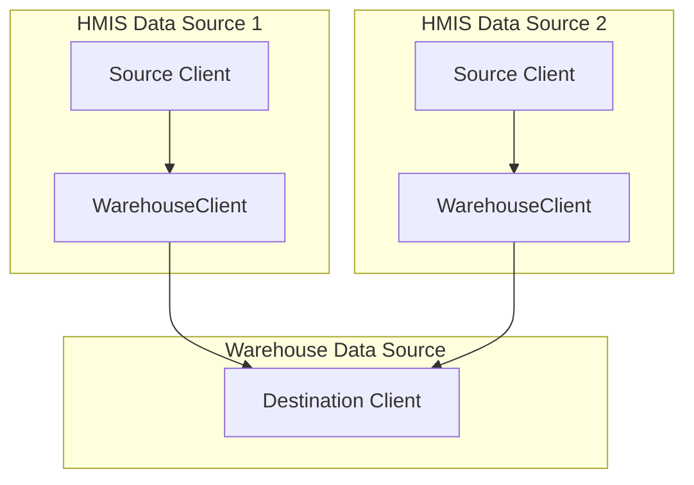

---
sources:
  - app/models/grda_warehouse/tasks/identify_duplicates.rb
  - app/models/grda_warehouse/tasks/identify_duplicates_query_matcher.rb
  - app/models/grda_warehouse/client_match.rb
  - app/models/grda_warehouse/tasks/client_cleanup.rb
  - app/models/grda_warehouse/dob_selector.rb
  - app/jobs/client_cleanup_job.rb
  - app/models/grda_warehouse/warehouse_client.rb
  - app/jobs/importing/run_daily_imports_job.rb
  - drivers/hmis/app/models/hmis/hud/client.rb
---

# Duplicate Client Identification Algorithm

`IdentifyDuplicates` deduplicates client records by identifying and linking clients that represent the same person across different data sources.

## Architecture Overview

The system operates on a **source-destination architecture**:

- **Source clients**: Original client records from HMIS data sources
- **Destination clients**: Deduplicated warehouse records (stored in destination data source)
- **WarehouseClient**: Junction table linking source clients to their destination client

### Key Models

- **`GrdaWarehouse::Hud::Client`**: Source and destination client records
- **`GrdaWarehouse::WarehouseClient`**: Links source to destination clients
- **`GrdaWarehouse::ClientMatch`**: Tracks candidate matches for review
- **`GrdaWarehouse::ClientSplitHistory`**: Prevents re-merging manually split clients
- **`GrdaWarehouse::IdentifyDuplicatesLog`**: Tracks algorithm execution statistics

### Data Flow

## Understanding "Unprocessed" vs "Processed"

**Unprocessed Clients**: Source clients without a `WarehouseClient` record (newly imported, not yet linked to a destination)

**Processed Clients**: Source clients with an existing `WarehouseClient` record linking them to a destination

This distinction is fundamental because:

- `identify_duplicates` processes unprocessed sources → links them to destinations
- `match_existing!` merges already-processed destinations → consolidates duplicates

### Matching Method Variants

Each matching criterion has two implementations with different return types:

| Method | Returns | Used By | Compares |
|--------|---------|---------|----------|
| `exact_ssn_matches` | `[dest_id, dest_id]` | `match_existing!` | destination ↔ destination |
| `exact_ssn_matches_for_unprocessed` | `[dest_id, source_id]` | `identify_duplicates`, `ensure_source_client_linked!` | destination ↔ unprocessed source |

Similar method pairs exist for name and DOB matching. The different return types reflect different architectural needs: linking new clients vs merging existing ones.

## Main Operations

The system provides three operations that handle different deduplication scenarios:

### Operation 1: `identify_duplicates` - Process New/Unprocessed Clients

**Purpose**: Handles newly imported or created clients that need to be linked to existing destinations or have new destinations created

**When `identify_duplicates` runs** (via `run!`):

- As part of the daily processing script (`Importing::RunDailyImportsJob`)
- At the end of each HMIS CSV import (`HmisCsvImporter::Importer::Importer#post_process`)
- From `HmisSimulation::WarehouseSyncer`
- Inline from `Hmis::UndoMergeClientsJob`
- Queued by `Hmis::Hud::Client.warehouse_identify_duplicate_clients` (fake enrollment generation, MCI imports) through `enqueue_full_run!`, unless a run is already queued
- Via manual execution (`Importing::RunIdentifyDuplicatesJob`, rake tasks)

**What `identify_duplicates` does**:

1. Recovers orphaned records by finding and restoring any destination clients that were previously soft-deleted but are still referenced by active source clients, and forces a full service history rebuild for each. This prevents data loss and ensures consistency.
2. Identifies all source clients that have not yet been linked to a destination client in the warehouse. This is the pool of clients that will be processed.
3. For each unprocessed client, the system searches for a matching destination client by applying the **Matching Criteria** defined below. When several destinations qualify, the one with the highest id wins.
4. If a match is found, the unprocessed source client is linked to the existing destination client. If no match is found, a new destination client is created from the source client's data and then linked.
5. When linking to an existing destination, the system enriches the destination record by filling in any missing SSN, DOB, FirstName, or LastName information from the source client.
6. Invalidates the service history for any clients that are matched to an existing destination, flagging it for future rebuilding.
7. Finalizes pending matches by automatically accepting any previously proposed client matches that are now confirmed to be exact duplicates based on the latest data (`ClientMatch.accept_exact_matches!`, which ends by running `ServiceHistory::Add` inline).

### Operation 2: `match_existing!` - Merge Existing Destinations

**Purpose**: Identifies and merges existing destination clients that are duplicates of one another.

**When `match_existing!` runs**:

- When an HMIS client's personally identifiable information is updated
- Via manual execution for reconciliation
- As part of the daily processing script
- From `HmisSimulation::WarehouseSyncer`

**What `match_existing!` does**:

1. Finds potential duplicates by applying the **Matching Criteria** defined below, while also filtering out any client pairs that were previously manually split by an administrator.
2. Resolves merge chains: When client A matches B and B matches C, the system identifies the transitive relationship and groups the clients so they can be merged into a single destination record. Depending on id order, a member can be left out of the chain and merge on the next run instead.
3. Manages merge size: it respects a pre-defined limit (`MAX_SOURCE_CLIENTS`) on the number of source clients that can be merged into one destination. Outside production, a chain over the limit is split: one of the clients from the match group is promoted to become a new destination.
4. Executes the merge with `merge_from`, which moves the source clients and dependent records to the surviving destination and deletes the merged-away destination once it has no source clients left. `match_existing!` then queues `ClientCleanupJob` for each batch of merged clients.
5. Invalidates the existing service history for all clients involved in a merge, then runs `ServiceHistory::Add` inline at the end of the run (when `run_post_processing` is true, the default) to rebuild a consolidated service history.

### Operation 3: `ensure_source_client_linked!` - Link One New Client

**Purpose**: Links a single newly created source client to an existing destination or creates one for it.

**When `ensure_source_client_linked!` runs**:

- After an HMIS client is created (enqueued from `after_commit` on the `short_running` queue, one job per client)
- From `Hmis::MergeClientsJob` when it carries a warehouse restriction to a retained client that is not linked yet

**What `ensure_source_client_linked!` does**:

1. Takes the same `identify_duplicates` advisory lock as the full run, waiting up to 5 seconds. If a full run holds the lock, it enqueues a full run instead so the client is still processed.
2. Returns without changes if the source is already linked, soft-deleted, or not a source client.
3. Runs the same **Matching Criteria** queries as the full run, restricted to this source and to destination clients that share its valid SSN or its DOB.
4. Processes the newly matched client as with the batch process if a match is found, otherwise creates a new destination from the source.
5. Marks the destination dirty for Coordinated Entry, writes an `identify_duplicates_log` row with `to_match: 1`, and queues a background service history rebuild for the destination.

It does not restore deleted destinations or accept pending `ClientMatch` candidates; the full run still handles those.

### Why Separate Operations?

**Logical Separation**:

- **New client processing**: Handles incremental addition of clients over time, and additional bulk imports of client data.
- **Existing client reconciliation**: Handles changes to existing client records that are updated. Sometimes an update to an existing source record causes a deterministic match to another existing client pair.

**Performance Benefits**:

- Avoids expensive re-evaluation of all relationships when processing new clients
- Separates costly merge operations from routine client processing
- Enables efficient batch processing of imports
- Prevents performance degradation as the system scales

## Matching Criteria

The system requires **2 of 3** exact matches across these normalized fields:

### Social Security Number

- Must pass validation checks
- Excludes obvious test values and placeholders

### Full Name

- Normalized to handle variations in formatting and accented characters
- Strips non-alphanumeric characters
- First and last name must both be present

### Date of Birth

- Must be reasonable (after 1920)
- Requires exact date match

### What is compared

- **Linking** (`_for_unprocessed` queries) compares the unprocessed source client with the destination client row's own columns.
- **Merging** (`match_existing!`) compares the source clients of two destinations.

## Configuration and Constraints

### System Controls

- `enable_auto_deduplication`: Controls whether the system automatically identifies and merges duplicate client records
- `identify_duplicates/use_query_matcher_for_existing_matches` (`AppConfigProperty`): picks the SQL behind the existing-match queries used by `match_existing!`. See [Which SQL runs](#which-sql-runs).

### Safeguards

- Advisory locks prevent concurrent execution of `run!` and the per-client path. Both wait up to 5 seconds for the lock and enqueue a full run if it is still held, so an import that overlaps a per-client run is never silently skipped. `match_existing!` takes no lock.
- Respects manual administrative decisions about client splits
- Maintains audit trails of operations
- The full run computes its unprocessed list once, at the start. A source client created during the run is left for the next run.
- `match_existing!` reports a failed merge to Sentry and moves on to the next pair, so one bad pair does not stop the nightly job. It skips a destination that a concurrent merge left with no source clients.

## Performance Optimizations

### Database-Level Processing

- **Efficient Matching**: Perform all matching logic in SQL to avoid the overhead of loading records into the application and comparing them in Ruby.
- **Bulk Operations**: Perform bulk inserts and updates for new destination clients and warehouse links. This reduces the number of individual database queries to allow for processing large client record sets.

### Batching and Memory Management

- **Batch Processing**: Both `identify_duplicates` and `match_existing!` process records in manageable chunks (e.g., using `find_in_batches` and `each_slice`) to keep the memory footprint low.
- **In-Memory Caching**: Expensive or frequently accessed records are memoized (such as the list of previously split clients)

## Monitoring and Error Handling

### Logging

- Tracks operation statistics and performance
- Sends alerts to Sentry

### Safety Measures

- Handles missing or invalid data gracefully
- Uses database transactions for critical operations
- Provides alerts for edge cases and system limits

## Gotchas

### Two switches, two meanings

- `enable_auto_deduplication` off means no exact matching at all: every unlinked source client gets its own new destination, and `match_existing!` and `accept_exact_matches!` return early.
- `auto_de_duplication_enabled` is a different key. It only governs threshold-based auto-accept and auto-reject of statistical `ClientMatch` rows.

### Querying people vs records

- A `Hud::Client` id in a URL, cohort, or report is a destination id. Enrollments and services hang off source clients by `PersonalID` plus `data_source_id`.
- `Hud::Client.where(...)` with no `.source` or `.destination` scope returns both kinds of row. Go from destination to HUD data through `source_clients`, and from source to person through `destination_client`.
- Destination demographics (name, SSN, DOB, race, gender, sex, veteran status) are owned by `ClientCleanup`, not by imports. Do not pick a name or DOB in a view by looking across `source_clients`; use the destination's columns, or `SourceClientNameSet` for aliases.
- Do not hand-roll merges (`update_all(destination_id:)`, deleting a destination). Use `merge_from`, which moves dependent items, invalidates service history, deletes `processed_sources` and `candidate` `ClientMatch` rows for every moved source, writes `ClientMergeHistory` when it destroys the old destination, and queues cleanup unless called with `cleanup: false`. Do not detach a source by deleting its `WarehouseClient`; that makes the source unprocessed, and the next `run!` re-links it to a matching destination (usually the one it left), even when a `ClientSplitHistory` row exists. Use `split`.

### Matching internals

- Each exact-match method has legacy SQL and an `IdentifyDuplicatesQueryMatcher` implementation. A filter has to be changed in both until the legacy methods are removed.
- Source clients hidden from interactive lookups (identities restricted in HMIS or the warehouse, identities with a retention mark) are not filtered by the `IdentifyDuplicates` or `ClientMatch` paths, so hidden clients still merge.
- `DataSource.source_data_source_ids` and `destination_data_source_ids` are cached for an hour and cleared when a data source is created, so a data source reclassified (source, destination, or authoritative) mid-run may not be recognized until the cache expires.

### ClientMatch rows

- Both sides of a `candidate` row are source clients, despite the `source_client` / `destination_client` column names. Code that needs the person calls `.destination_client` on each side.
- `processed_sources` rows are bookkeeping that mark a destination as scanned (both ids are the destination's id). Count `ClientMatch` with a status scope, or candidates are overstated.
- `accept!` merges only the match's one source client into the other's current destination, so a single `WarehouseClient` row moves.
- `accept_exact_matches!` compares more loosely than the SQL matching: names are compared exactly as stored, without normalization, and DOB has no 1920 floor. It also deletes candidates whose clients no longer exist.

### Merge and split

- `merge_from` raises unless the receiver is a destination (`destination?`, which means it has source clients). A warehouse restriction on the previous destination carries to the receiver; an external-data-sharing exclusion carries only when the previous destination is destroyed. Restricting a receiver outside a destination data source raises and rolls back the merge.
- A split is not an undo of a merge. It does not read `ClientMergeHistory`, does not restore the destroyed destination, and creates new destination ids. Only one detached client can receive notes, files, VI-SPDATs, cohort memberships, CE assessments, or custom data elements; everything else stays with the original. The original destination's warehouse restriction and external-data-sharing exclusion carry to every new destination.
- `ClientSplitHistory` only blocks `match_existing!`. A brand-new source that exactly matches two destinations that were split from each other is attached to the one with the highest id; a reviewer can split again.
- `splits_to` / `splits_from` on `Hud::Client` are named inversely to their foreign keys (`split_from` and `split_into`). Read the `foreign_key` before using either.

### Destination attribute rules (`ClientCleanup`)

- Name: take the best `NameDataQuality` tier (1, 2, 8, 9, 99), then earliest or latest `DateCreated` per the `warehouse_client_name_order` config (default earliest).
- DOB: with `dob_selection_method` set, `GrdaWarehouse::DOBSelector` picks by `DOBDataQuality` first, then by the oldest or newest source record (`DateCreated`), never by the earliest or latest birth date. Otherwise the legacy data-quality tier walk applies. A DOB change invalidates service history.
- Gender and race: per column, newest source first, and a 0 or 1 wins.
- Because each field is chosen independently, a destination's demographics can combine values from several sources and may not match any single source record.
- `Hmis::MergeClientsJob` reuses `choose_attributes_from_sources`, so changing a `choose_best_*` rule changes HMIS merge results too. That job and `Hmis::UndoMergeClientsJob` change `WarehouseClient` rows directly. `UndoMergeClientsJob` runs `run!` inline to re-link sources; both rely on the next `ClientCleanup` run to repair destination attributes.
- `WarehouseClient` does not use `acts_as_paranoid`. Its `deleted_at` is set by `ClientCleanup`: a run that finds destinations with no live source client left clears it on every row, then sets it on those destinations' links. A run that finds none leaves it alone, so `deleted_at` is not a reliable sign that a link is live. `ClientCleanup` maintains it because external analytics tooling reads it.

### Which SQL runs

The legacy existing-match queries (`exact_ssn_matches`, `exact_name_matches`, `exact_dob_matches`) self-join source clients, so their cost grows with the square of the number of rows sharing a value and they can hit the statement timeout at large installations. `IdentifyDuplicatesQueryMatcher` groups rows into arrays of destination ids first and returns the same pairs. `match_existing!` uses it when the `AppConfigProperty` row `identify_duplicates/use_query_matcher_for_existing_matches` holds the JSON boolean `true`. Any other value, including the string `"true"`, keeps legacy, and a change applies on the next run.

- To switch back to legacy, delete the row. The admin form can't save `false`, because `AppConfigProperty` validates that `value` is present.
- The `_for_unprocessed` methods always use legacy SQL. The matcher's unprocessed query aggregates the whole destination table and is not used in production.

### Daily job order

`RunDailyImportsJob` runs Identify Duplicates (`run!`, `match_existing!`, `ClientMatch.auto_process!`), then `ClientCleanup`, then service history generation, so a merge made tonight is reflected in tonight's service history. `ClientCleanup` runs again at the end, and statistical candidate generation runs last in system maintenance, so new candidates aren't auto-accepted or auto-rejected until the next night.

### Concurrency

Per-client linking is triggered after commit (not after create) because the job queue is in a different database and the client row must exist first. Updating an HMIS client's name, DOB, SSN, or deletion date queues `match_existing!` unless one is already queued. These callbacks fire only on saves through the model; `update_columns`, `update_all`, and raw SQL skip them, so after correcting PII at the console, queue `match_existing!` yourself. `ClientCleanupJob` re-queues itself a minute out when another `ClientCleanupJob` is running, so one runs at a time.

## Related

- [HMIS Client Merges](../hmis/hmis-client-merges.md): merging and unmerging clients in the HMIS app, and how those jobs call into this one.
- [HMIS CSV Importer](hmis-csv-importer.md): the import that runs `run!` in its post-processing.
- [PII and Restricted Clients](pii-and-restricted-clients.md): the hidden and restricted clients that are filtered from lookups but still matched.
- [App Config Property](app-config-property.md): the key-value store that holds the query-matcher flag.
- [Warehouse building blocks](../../architecture/05-building-blocks/05-2-1-warehouse.md) and [Risks, R-2](../../architecture/11-risks.md): where deduplication sits in the warehouse, and the accuracy risk it carries.
