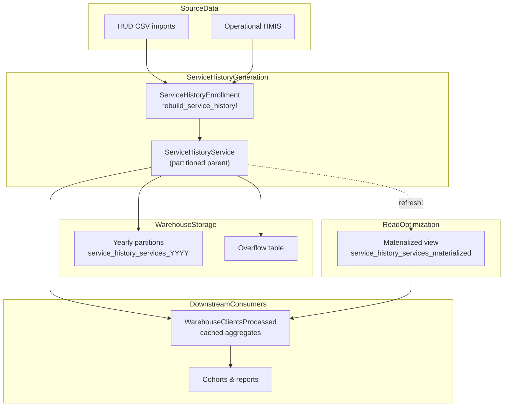

---
sources:
  - app/models/grda_warehouse/tasks/service_history/enrollment.rb
  - app/models/grda_warehouse/tasks/project_cleanup.rb
  - app/models/grda_warehouse/tasks/client_cleanup.rb
  - app/models/concerns/hud_concerns/enrollment.rb
  - drivers/hmis/app/models/hmis/hud/enrollment.rb
  - drivers/hmis/app/graphql/mutations/split_household.rb
  - app/models/grda_warehouse/service_history_service.rb
  - app/models/grda_warehouse/service_history_service_materialized.rb
  - app/models/grda_warehouse/warehouse_clients_processed.rb
  - app/jobs/importing/run_daily_imports_job.rb
  - app/jobs/update_warehouse_clients_caches_job.rb
  - app/models/grda_warehouse/tasks/service_history/purge_for_deleted_data_sources.rb
---

# Service History

Service history is a flattened, day-by-day record of each client's enrollments, built from HUD source data. `GrdaWarehouse::ServiceHistoryEnrollment` (`service_history_enrollments`) holds the entry and exit rows for each enrollment, and `GrdaWarehouse::ServiceHistoryService` (`service_history_services`) holds one row per service day. Reports, cohorts, and CAS read it directly or through the per-client cache in `GrdaWarehouse::WarehouseClientsProcessed`.

This doc covers how service history is built, when it is rebuilt, and that cache. How episodes and chronic homelessness are calculated from it is covered in [Homeless Episodes](homeless-episodes.md).

## Key Models

-   **`ServiceHistoryEnrollment`**: Each HUD enrollment produces one or more `ServiceHistoryEnrollment` rows that mark the lifecycle of the enrollment. We always create an `entry` record and we add an `exit` record when the enrollment closes. These markers allow downstream jobs to reason about the enrollment span independently of the daily service rows.
-   **`ServiceHistoryService`**: This model stores the daily activity generated for a `ServiceHistoryEnrollment`. It represents days for both source services and synthetic days representing CLS in Street Outreach programs. This is time-series data; it is extremely large and partitioned by year to keep it manageable.
-   **`ServiceHistoryServiceMaterialized`**: Rails model backed by a materialized view that flattens the sharded `service_history_services` partitions for per-client and ad-hoc analytic queries. The `WarehouseClientsProcessed` homeless-day counts read it instead of the live partitions.

## Service History Generation

The `ServiceHistoryEnrollment` and its associated `ServiceHistoryService` records are generated by a background task. This process is idempotent and can be re-run safely. The core logic resides in the `rebuild_service_history!` method within the `GrdaWarehouse::Tasks::ServiceHistory::Enrollment` class.

`on_duplicate_key_update` doesn't work on the partitioned table, so the builder rescues unique and foreign key errors instead. A crash between inserting the entry row and inserting the service days leaves entry rows with no days until the next hash mismatch or sanity check.

The system uses two strategies to keep service history current:

-   **Full rebuild:** When source data has changed (detected via hash mismatch), the system deletes the enrollment's existing service history and regenerates it from scratch. This ensures correctness when enrollment fields, services, exits, or client data have been modified.
-   **Incremental patch:** When the source data hash still matches but an open enrollment has advanced past its last build date (e.g., a new calendar day), the system appends only the missing days without touching existing records. This keeps daily processing efficient for long-running open enrollments.

The generation logic differs based on the program type:

-   **Night-by-Night (NBN) Programs:** A `ServiceHistoryService` record is created for each specific service date recorded in the source data (e.g., a bed night service).
-   **Entry/Exit Programs:** For programs like Entry/Exit shelters, Transitional Housing, and Permanent Housing, the system builds `ServiceHistoryService` records for each day from the client's entry date through the day before their exit date. When the entry and exit dates are the same we include that day. For ongoing enrollments, we extend the services through the latest date covered by the source export (or today, if the enrollment is managed in the operational HMIS).
-   **Street Outreach & Contact Extrapolation:** Street Outreach projects can create synthetic daily services from contact records. When the `so_day_as_month` configuration flag is enabled—or when a project is configured to extrapolate contacts—we expand each recorded contact to fill its full calendar month (including days before the contact within that month, never past today). A single contact in a month counts as a full month of engagement for HUD reporting purposes, so this gives downstream reports and chronic-homelessness calculations a continuous timeline rather than isolated contact points.

## Homelessness Classification

Each `ServiceHistoryService` row carries two boolean flags — `homeless` and `literally_homeless` — that downstream reports and scopes use to filter service days. The values are determined by the enrollment's project type and, for Permanent Housing, by the move-in date:

| Project type | `homeless` | `literally_homeless` |
|---|---|---|
| ES, SO, SH, TH | `true` | `true` for ES/SO/SH; `false` for TH |
| PH before move-in date, or without one | `nil` | `nil` |
| PH on or after move-in date | `false` | `false` |
| Services Only, Other, Day Shelter, CE | `nil` | `nil` |

The move-in day is the first `false` day. The flip uses the enrollment's own `MoveInDate`, not the household-derived `move_in_date` copied onto the `ServiceHistoryEnrollment` row. The `currently_homeless` and `hud_currently_homeless` scopes on `ServiceHistoryEnrollment` don't read these flags; they take ongoing entry rows in homeless types and exclude clients with an ongoing PH enrollment moved in on or before the date.

A `nil` value means the day is neither homeless nor not-homeless — it will not appear in `homeless` or `non_homeless` scopes. This three-state design lets reports distinguish "known homeless," "known housed," and "not categorized" service days. The episode rules in [Homeless Episodes](homeless-episodes.md) read these flags directly: `literally_homeless = true` nights keep an episode open, `homeless = false` and TH nights count toward a housed break.

The `ProjectCleanup` daily task (see "Automatic Rebuild via Daily Project Cleanup Task" below) detects mismatches between these flags and the current project type configuration, triggering rebuilds when needed.

## Storage & Performance Considerations

 The `service_history_services` dataset is among the largest tables in the warehouse regardless of installation scale. To keep inserts fast and maintenance manageable, we physically shard it by year. PostgreSQL declarative range partitioning (see `db/warehouse_structure.sql`) routes each new service day into the correct annual partition (`service_history_services_2000`, `service_history_services_2001`, …, `service_history_services_2050`) with an overflow table (`service_history_services_remainder`) for out-of-range data. Queries continue to reference the parent `service_history_services` relation, but PostgreSQL prunes to the relevant partitions based on date filters. A query without a `date` predicate scans every partition. The `service_between`, `on_date`, and `homeless_between` scopes add one.

The partition range is fixed at 2000 to 2050 in both the schema and `ServiceHistoryService.table_years`, so adding a year needs a schema change and a `table_years` update.

For analytic workloads that benefit from a consistent snapshot—and to avoid the cross-partition overhead of per-client lookups—we expose the `service_history_services_materialized` relation. The `GrdaWarehouse::ServiceHistoryServiceMaterialized` model manages that materialized view, including `refresh!` (to repopulate it) and `rebuild!` (to drop, recreate, and reindex). `refresh!` is a plain `REFRESH MATERIALIZED VIEW`, which blocks readers while it runs. A notifier-backed `double_check_materialized_view` helper compares recent homeless dates between the live partitions and the materialized copy so we can detect drift.

There are some guard rails in place so we don't generate service back to the year 100 or far into the future. Enrollments with an entry date before the earliest allowed date are refused, and open enrollments are built only through today or the export's effective end date.

### Data Flow Overview



## When Service History Records Are Updated

Service history uses a hash-based caching mechanism to avoid unnecessary rebuilds. Each enrollment stores a `processed_as` hash that represents the state of the source data at the time the service history was last generated. The system automatically rebuilds service history when it detects that source data has changed.

### Automatic Rebuild Triggers

Service history regenerates when any of the following source data changes. `GrdaWarehouse::Tasks::ServiceHistory::Enrollment#calculate_hash` defines the exact fields; this is a summary.

-   **Enrollment data:** Entry date, project, household ID, relationship to head of household, move-in date
-   **Exit data:** Exit date, destination
-   **Service records:** Date provided, additions or deletions of service records (for Night-by-Night projects)
-   **Current Living Situations:** Information dates for Street Outreach projects that act as bed-night
-   **Client data:** Changes to the destination client (e.g., after client merges)

Two consequences of what the hash covers:

- The hash covers `ProjectID`, not the project's type. A type change is caught by `ProjectCleanup` (it compares the type on existing service history rows to the project), which forces the rebuild. Until the nightly job runs, flags reflect the old type.
- Current Living Situations are hashed only for Street Outreach projects, so a CLS change on any other enrollment doesn't trigger a rebuild.

`rebuild_service_history!` is a no-op for an exited entry/exit enrollment whose exit date is later than its last build date. Invalidate `processed_as` to force work on it. The batch job rebuilds each enrollment on its own and records the outcome in `processing_error` (cleared on success), so one failing enrollment doesn't stop the batch.

Don't write to `service_history_enrollments` or `service_history_services` from feature code. `GrdaWarehouse::Tasks::ServiceHistory::Enrollment` is the only writer; invalidate and let the builder run. Enqueue rebuilds through `ServiceHistory::Builder.queue_enrollments`, which takes the advisory lock and skips ids already queued, rather than enqueuing the batch job directly. Use the stored `homeless` flags or `HudHelper.util` project type lists instead of hard-coding project type numbers.

### Automatic Rebuild via Daily Project Cleanup Task

A daily `ProjectCleanup` task automatically detects and fixes several types of project-related inconsistencies:

-   **ProjectType changes:** When a project's `ProjectType` changes or doesn't match service history, the task automatically invalidates all enrollments for that project to trigger a rebuild
-   **Project moves:** When a project is moved to a different organization, associated service history is invalidated and rebuilt
-   **Homeless status mismatches:** When the `homeless` or `literally_homeless` flags in service history don't match what they should be for the project's type (checked for the last 2 years), enrollments are invalidated
-   **Project name changes:** Project names in service history are automatically updated when they don't match the source

The cleanup task runs on all projects daily and then processes the invalidated enrollments.

### Automatic Rebuild via HMIS Edits

The operational HMIS is a third rebuild trigger, alongside the CSV importer and the daily `ProjectCleanup` task. When records are saved through the HMIS app, model callbacks automatically clear the enrollment's processed state and queue the same batch rebuild job.

Four models carry this behavior: `Hmis::Hud::Enrollment`, `Hmis::Hud::Exit`, `Hmis::Hud::Service`, and `Hmis::Hud::CurrentLivingSituation`. Each checks whether the fields relevant to a service history rebuild actually changed before doing anything — saves that touch unrelated fields are ignored. Exit, Service, and CLS records invalidate their **parent enrollment** rather than themselves, since service history is keyed by enrollment.

`Hmis::Hud::Enrollment` uses `after_create` and `after_update`; the other three use `after_save`. None use `after_commit`, deliberately: `after_save` gives reliable access to `saved_changes` within a transaction, at the cost of occasionally queuing a redundant rebuild if the transaction is later rolled back. The queue is de-duplicated so rapid edits do not pile up jobs. Shared queuing logic lives in `Hmis::Hud::Concerns::ServiceHistoryQueuer` (`drivers/hmis/app/models/hmis/hud/concerns/service_history_queuer.rb`).

These callbacks invalidate only the edited enrollment, not the rest of its household. See "Reprocessing a whole household" below.

### Invalidating enrollments

Two methods clear an enrollment's processed state:

| Method | Defined on | Clears | Scope |
|---|---|---|---|
| `invalidate_processing!` (instance and relation) | `HudConcerns::Enrollment`, so every enrollment model | `processed_as` and `processed_hash` | Only the given enrollment(s) |
| `invalidate_source_data!` | `GrdaWarehouse::Tasks::ServiceHistory::Enrollment` only | `processed_as` | The enrollment and every enrollment sharing its `HouseholdID` and `data_source_id` |

`processed_as` is the only column the builder reads; `service_history_valid?` compares it to `calculate_hash`. No code in this repo reads `processed_hash`, so clearing it has no effect on whether an enrollment rebuilds. The header comment in `GrdaWarehouse::Tasks::ClientCleanup` that says to clear `processed_hash` to force a rebuild is out of date.

Neither method enqueues a rebuild. The caller enqueues one separately, as in "Manual Rebuild Process" below.

### Reprocessing a whole household

Each `ServiceHistoryEnrollment` row carries values derived from the *other* enrollments in its household: `head_of_household_id`, the `other_clients_over_25` / `other_clients_under_18` / `other_clients_between_18_and_25` counts, the youth and family flags computed from those counts (`unaccompanied_youth`, `parenting_youth`, `children_only`, and others), `presented_as_individual` when `infer_family_from_household_id` is on, and `move_in_date`, which non-HoH members inherit from the HoH.

The hash only covers the enrollment's own rows: its enrollment, exit, services, destination client, and (for Street Outreach) CLS. A change to one household member does not change any other member's hash, and the builder has no step that pulls in the rest of the household. The caller is responsible for invalidating every affected member.

For example, if one member of a household with an adult and a child is deleted, the remaining adult's row still reports `other_clients_under_18: 1` until that adult's enrollment is also invalidated and rebuilt. The same applies when the HoH changes, when a member is added or moved between households, or when the HoH's move-in date changes.

Callers handle this in one of two ways:

- Call `invalidate_source_data!` on a `GrdaWarehouse::Tasks::ServiceHistory::Enrollment`, which clears the whole household.
- Invalidate each member explicitly. The HMIS `SplitHousehold` mutation does this: it calls `invalidate_processing!` on the enrollments that remain in the donor household, because their composition changed.

The HMIS model callbacks above do neither, so an HMIS edit that changes household composition (for example `RelationshipToHoH` or `MoveInDate` on the HoH) leaves the other members' rows stale until something else invalidates them.

The nightly `ClientCleanup` run catches only part of this. `invalidate_incorrect_family_enrollments` re-checks `presented_as_individual` against the project or household and invalidates mismatches. Nothing re-checks the head of household, the age counts, the youth flags, or the inherited move-in date.

### Nightly ordering

`RunDailyImportsJob` runs service history after consent, ETO, CAS sync, duplicate identification, and project and client cleanup. Identifying duplicates before generation means a merge done tonight is reflected in tonight's service history, because the destination client id is part of the hash. Generation starts with `GrdaWarehouse::Tasks::ServiceHistory::PurgeForDeletedDataSources`, which deletes the service history rows of data sources soft-deleted at least 24 hours earlier. Client cleanup runs again after generation. The client retention job is enqueued after duplicate identification and cleanup have rewritten the warehouse client links, and does nothing unless a retention period is configured.

### Manual Rebuild Process

The steps below are required in two situations: targeted developer intervention, and **any console-level data fix**. When records are corrected directly via `update_columns`, `update_all`, raw SQL, or bulk import, the model callbacks do not fire — neither the processed-state clear nor the job enqueue happens automatically. The operator must perform both steps explicitly.

To manually trigger a service history rebuild for specific enrollments:

```ruby
# Invalidate an enrollment and the rest of its household.
# invalidate_source_data! exists only on the ServiceHistory task class.
enrollment = GrdaWarehouse::Tasks::ServiceHistory::Enrollment.find(enrollment_id)
enrollment.invalidate_source_data!

# Or invalidate all enrollments for a project (this covers whole households)
GrdaWarehouse::Hud::Enrollment.where(
  ProjectID: project_id,
  data_source_id: data_source_id
).invalidate_processing!

# Queue for reprocessing
GrdaWarehouse::Tasks::ServiceHistory::Enrollment.queue_batch_process_unprocessed!
```

For a single enrollment, you can also directly call:

```ruby
enrollment.rebuild_service_history!
```

This will check the hash and rebuild, patch, or no-op as appropriate. To force a full rebuild regardless of hash state, invalidate first:

```ruby
enrollment.invalidate_source_data!
enrollment.rebuild_service_history!
```

## Importance for Reporting and Analysis

Because `ServiceHistoryService` creates a daily record for Entry/Exit programs, it allows complex, time-based queries to be written in a simple and efficient way. For example, to determine if a client was active on a specific date, a query only needs to check for the existence of a `ServiceHistoryService` record for that client on that date.

This flattened data structure is used for:
-   Calculating "last seen" dates.
-   Determining program occupancy on a given day.
-   Accurately calculating length of stay.
-   Reporting on client activity over time.

## Cached Service History Data (`WarehouseClientsProcessed`)

While Service History provides the day-by-day foundation, many features don't query it directly. Instead, they rely on **pre-computed aggregations** stored in the `WarehouseClientsProcessed` table for performance.

### What Gets Cached

The `WarehouseClientsProcessed` table stores aggregated metrics for each client, including:

- **`last_homeless_date`**: Most recent date with a homeless service from `ServiceHistoryService`
- **`first_homeless_date`**: First date with a homeless service
- **`homeless_days`**: Total count of days homeless
- **`last_chronic_date`**: Most recent date when client was chronically homeless
- **`days_homeless_last_three_years`**: Days homeless within the last 3 years
- **`literally_homeless_last_three_years`**: Days literally homeless within the last 3 years
- **`last_intentional_contacts`**: JSON array of the most recent intentional contacts, including:
  - Current Living Situations (CLS) from any enrollment in the last 3 years
  - CE Events from any enrollment in the last 3 years
  - Referral Events from any enrollment in the last 3 years
  - Custom services
- **`last_exit_destination`**: Most recent exit destination

Clients on an active cohort or active in CAS also get ongoing-enrollment flags, household members, and CAS match fields. The "Ongoing RRH Enrollments" last visit leaves out RRH: Services Only.

The homeless-day counts read the materialized view, not the live table, and exclude days that overlap a `homeless: false` PH day (and TH, for the literal variants). Extrapolated days are dropped from most-recent dates unless the `ineligible_uses_extrapolated_days` config is on.

### When the Cache Is Updated

The cache is updated automatically by:

1. **Daily Import Job**: `RunDailyImportsJob` automatically updates cached counts for all clients (from the past year) after service history generation completes
2. **Daily Cohort Preparation**: `Cohort.prepare_active_cohorts` runs nightly (via the `warm_cohort_cache` rake task) and updates the cache for a set of clients who are on the cohort prior to updating the cohort-level cache so it can have the most accurate information and ensure the cache has been created for the particular clients.
3. **On-Demand Jobs**:
   - `AddCohortClientsJob` updates the cache when clients are added to cohorts
   - `UpdateWarehouseClientsCachesJob` can be queued for specific client sets

`GrdaWarehouse::Tasks::ServiceHistory::Add` also updates the cache for the clients it processes. Outside those scheduled places, `UpdateWarehouseClientsCachesJob.perform_later(client_ids: [ids])` updates specific clients. It takes an advisory lock and requeues itself if another update holds it.

With no client ids, `update_cached_counts` covers only clients with an enrollment open in the last year. Older clients keep stale rows until their ids are passed explicitly.

Because the counts read the materialized view, an on-demand update right after a rebuild reports stale numbers until the view is refreshed. The nightly job refreshes the view before updating.

### Features That Use Cached Data

The cached data in `WarehouseClientsProcessed` is used by:

- **Cohorts**: To determine client inactivity (checks `last_homeless_date` and `last_intentional_contacts` against the cohort's `days_of_inactivity` threshold)
- **CAS (Coordinated Access System)**: To determine if clients are actively homeless for eligibility
- **Reports**: Various reports use the cached metrics for performance
- **Client Dashboards**: Display last service dates and activity metrics

## RRH: Services Only

HUD FY2024 added `Project.RRHSubType`. RRH projects with sub-type 1 (Services Only) don't provide the housing
assistance themselves, but HUD still collects a Housing Move-in Date when the household moves into permanent housing
paid for by another source.

The warehouse rule: an RRH enrollment of any sub-type with a move-in date counts as permanent housing from the move-in
date. An RRH: Services Only enrollment without a move-in date never counts as in housing.

- Service history marks every PH day on or after the move-in date `homeless: false`, regardless of sub-type.
  An RRH: Services Only enrollment without a move-in date never gets `homeless: false`, so logic driven by
  `homeless: false` follows the rule with no sub-type check.
- Performance Measurement bed utilization counts a permanent housing bed night only on or after the
  move-in date. RRH: Services Only nights never count, because HUD says those projects have no bed inventory.
- The "Enrolled in PH" cohort column reports enrollment in a housing project, so it excludes
  RRH: Services Only regardless of move-in date.
- The "Ongoing RRH Enrollments" cohort column lists RRH with housing only, so it excludes RRH: Services Only
  regardless of move-in date.
- Logic that requires a move-in date for any PH project type follows the rule and treats the move-in date as
  the first housed day: CAS `enrolled_in_rrh` and `moved_in_with_ph?`, the Currently Homeless cohort, the
  `ServiceHistoryEnrollment` scopes `currently_homeless` and `hud_currently_homeless`, chronic calculations,
  `Hud::Enrollment.housed`, and HMIS `client_is_housed`.
- `Project.residential` and its variants classify projects, not enrollments, and exclude RRH: Services Only
  regardless of move-in date. Reports built on them (public homeless population counts, outflow) leave
  RRH: Services Only out entirely.
- HUD report generators follow the HUD programming specifications instead of this rule.

## Related

- [Homeless Episodes](homeless-episodes.md): the episode and chronic calculations that read the `homeless` and `literally_homeless` flags.
- [Duplicate Client Identification](identify-duplicates.md): merges change the destination client id, which is part of the rebuild hash.
- [HMIS CSV Importer](hmis-csv-importer.md): the import that flags enrollments for rebuild and enqueues rebuild jobs in `post_process`.
- [Background Jobs](background-jobs.md): the full phase order of `RunDailyImportsJob`.
- [Data Sources](data-sources.md): soft deletion of a data source, which the nightly purge follows.
- [Cohorts](cohorts.md): inactivity checks that read the `WarehouseClientsProcessed` cache.
- [Warehouse building blocks](../../architecture/05-building-blocks/05-2-1-warehouse.md): where HUD reporting's use of service history sits in the architecture.
- [Quality scenario Q-11](../../architecture/10-quality.md): the expected regeneration of service history after a source change.
