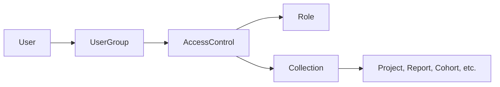

---
sources:
  - app/models/access_control.rb
  - app/models/collection.rb
  - app/models/concerns/entity_access.rb
  - app/models/concerns/user_permission_cache.rb
  - app/models/concerns/user_concern.rb
  - app/models/grda_warehouse/hud/project.rb
  - app/controllers/application_controller.rb
---
# Warehouse Permissions

The warehouse uses a scoped RBAC (Role-Based Access Control) system to determine what actions users can perform and which entities those actions apply to. Each permission grant combines a role (the actions), an entity scope (the targets), and a user group (the recipients). A parallel legacy system exists and is being phased out.

The codebase refers to this as the "ACL" system (and the model is named `AccessControl`), but it is structurally RBAC with entity scoping — not an access control list in the traditional sense.

## Core Concepts

The system answers two questions for every permission check:

1. **What can this user do?** (defined by Roles)
2. **Which entities does it apply to?** (defined by Collections)

These are joined through an `AccessControl`, which binds a `Role`, a `Collection`, and a `UserGroup` into a single grant.



## Models

### AccessControl

`app/models/access_control.rb`

The central join record. Each row connects exactly one Role, one Collection, and one UserGroup. A user receives the permissions defined by the Role, scoped to the entities in the Collection, if they belong to the UserGroup.

AccessControls where all three components are system-managed are hidden from the admin UI. The `user_managed` scope filters these out for the admin interface.

### Role

`app/models/role.rb`

A Role is a set of boolean permission flags stored as columns on the `roles` table. Each flag corresponds to a named permission (e.g., `can_view_clients`, `can_edit_projects`). Permissions are defined in `Role.permissions_with_descriptions`, which also provides metadata: description, category, sub-category, and whether the permission is administrative.

Roles come in three flavors:
- **Editable** — created and managed by administrators
- **System** — auto-managed (e.g., "System User Role"); hidden from normal admin views
- **Health** — assigned via `user_roles` (the legacy join), not through AccessControls

The ROI permissions `can_search_clients_with_roi` and `can_view_client_enrollments_with_roi` depend on a client's release of information; see [Client ROI and Consent](client-roi-and-consent.md).

Permissions are stored as columns rather than as a separate join table. Adding a new permission requires a schema migration: define it in `permissions_with_descriptions` and call `Role.ensure_permissions_exist` in the migration to add the column.

### Collection

`app/models/collection.rb`

A Collection groups the entities that a permission applies to. It holds references to entities through `GrdaWarehouse::GroupViewableEntity` (a polymorphic join table). A Collection has a `collection_type` that constrains which entity types it contains:

| `collection_type` | Allowed entity types |
|---|---|
| `Projects` | Data Sources, Organizations, Project Access Groups, CoC Codes, Projects |
| `Project Groups` | Project Groups |
| `Reports` | Reports |
| `Cohorts` | Cohorts |
| `Supplemental Data Sets` | Supplemental Data Sets |

Project-scoped rules are inclusive: a project is included if it appears directly in the Collection, or if its parent organization or data source is included.

**System Collections** (e.g., "All Data Sources", "All HMIS Reports", "All HUD Reports") are auto-maintained by `Collection.maintain_system_groups`. Their entity membership is locked. A "Hidden System Group" is bound to the system user's role and user group and still receives every report. Don't edit system collections, user groups, or roles by hand; the next sync overwrites the change or breaks the system-user grant.

**Source-backed Collections** are created by the `EntityAccess` concern as side-effects when entities like Cohorts or ProjectGroups manage per-entity access. These are hidden from admin views.

### UserGroup

`app/models/user_group.rb`

A named set of users. Membership is tracked through `UserGroupMember` records. UserGroups connect users to AccessControls — a user receives permissions from every AccessControl linked to their UserGroups.

System UserGroups are auto-managed (e.g., "System User Group" for the system user). Source-backed UserGroups are created by `EntityAccess` for per-entity viewer/editor access.

### GroupViewableEntity

`app/models/grda_warehouse/group_viewable_entity.rb`

Polymorphic join table linking entities to Collections (and, in the legacy system, to AccessGroups). Each row associates a `(collection_id, entity_type, entity_id)` triple. Supported entity types: `GrdaWarehouse::DataSource`, `GrdaWarehouse::Hud::Organization`, `GrdaWarehouse::Hud::Project`, `GrdaWarehouse::ProjectAccessGroup`, `GrdaWarehouse::WarehouseReports::ReportDefinition`, `GrdaWarehouse::ProjectGroup`, `GrdaWarehouse::Cohort`, `GrdaWarehouse::Lookups::CocCode`, `HmisSupplemental::DataSet`.

## How Permission Checks Work

### Boolean permission flags

`User` dynamically defines `can_<permission>` and `can_<permission>?` methods for every permission in `Role.permissions`. These methods merge the boolean flags from all Roles the user holds through their AccessControls (`load_effective_permissions`). Health permissions are loaded separately through the legacy `user_roles` join.

The flag check answers "can this user do X anywhere?" without regard to entity scope. `UserPermissions` (concern included by `UserConcern`) also defines composite methods that combine multiple flags (e.g., `can_view_or_search_clients`).

### Policies (preferred)

For resource-level authorization, `User#policy_for(resource)` returns a policy object from `GrdaWarehouse::AuthPolicies::`. Policies use a context object (`UserAclContext` or `UserLegacyContext`, selected by `User#using_acls?`) that resolves which entities the user can access for a given permission.

Key method: `User#collections_for_permission(permission)` returns the Collection IDs from AccessControls whose Role has the given permission enabled. Entity IDs are then resolved from those Collections.

`Project.viewable_by(user, permission:)` first requires `user.can_<permission>?`, then narrows by Collection. A true flag therefore does not mean access to a specific record. The `permission:` argument is ignored on the legacy branch, so specs for scope changes need a user on each `permission_context`.

Policies are the intended uniform API for authorization checks. New code should use `policy_for` rather than calling `can_*` directly on the User. Over time, direct boolean flag access from application code will be replaced by policy methods.

See also: [Warehouse Auth Policies](warehouse-auth-policies.md)

### HUD report access

HUD reports are ordinary report definitions in the `HUD Reports` report group (`GrdaWarehouse::WarehouseReports::ReportDefinition.hud`). Access to run one is granted like any other report: put the definition in a Collection bound to a Role with `can_view_assigned_reports`. The system Collection "All HUD Reports" (and the legacy AccessGroup of the same name) always holds every HUD definition, and "All HMIS Reports" excludes them, so granting the latter does not carry HUD access. The system Role "HUD Report Viewer" holds only `can_view_assigned_reports` and was bound to that Collection for every user group that had a HUD flag when access moved to collections.

`can_view_all_hud_reports` only widens which report *runs* a user can see (everyone's instead of their own). `can_view_own_hud_reports` is deprecated; own-run visibility is the default. Project scoping inside a HUD report comes from `can_view_assigned_reports` collections, the same as other reports.

Legacy users: a HUD flag on a legacy role counts as report access for HUD definitions only, so users who never had `can_view_assigned_reports` do not gain other reports that happen to be in their access groups.

### Controller authorization

Existing controllers check permissions with `before_action` callbacks that call `require_can_<permission>!` methods on `ApplicationController`. New controllers should inherit from `ApplicationControllerV2` (or include `ControllerAuthorizationV2`) and use the `authorize_with` class method instead:

```ruby
class MyController < ApplicationControllerV2
  authorize_with { current_user.policy_for(@resource).can_view? }
end
```

Rules for `authorize_with`:

- **Every action must be covered by at least one `authorize_with`.** A request to an uncovered action raises `AuthorizationNotPerformedError`.
- **The block must return `true` or `false`.** `true` authorizes, `false` calls `not_authorized!`, and anything else raises.
- **`only:`/`except:` must name actions that exist.** A misspelled name raises `ArgumentError` on every request that reaches the authorize_with check.

### Adding a viewable entity type

A new entity type that Collections can hold touches several places in `Collection`: the `has_many ... through: :group_viewable_entities, source_type:` association, `entity_types`, `relevant_entity_types`, `collection_type_from`, the `viewable_types` map, and the type list in `set_viewables`. It also needs the admin collection form params in `Admin::CollectionsController`, a `viewable_by` scope on the new model that resolves ids through `collections_for_permission`, and, for anything client-scoped, `ClientAccessControl::EnrollmentArbiter`.

Don't query `GrdaWarehouse::GroupViewableEntity` or `Collection` from feature code to decide access. That belongs in a model's `viewable_by` / `editable_by` scope or a policy context. To give users access to one cohort, project group, or data source, call `replace_access` rather than creating `Collection`, `UserGroup`, `Role`, or `AccessControl` rows by hand.

## EntityAccess Concern

`app/models/concerns/entity_access.rb`

Used by `GrdaWarehouse::ProjectGroup`, `GrdaWarehouse::Cohort`, and `GrdaWarehouse::DataSource` to manage per-entity user access. For each entity, it auto-creates system records:

- A **system Collection** containing only that entity
- A **viewable UserGroup** and an **editable UserGroup**
- Corresponding **system Roles** with the appropriate permission flag
- Two **AccessControls** binding the above together

This means the permission tables grow in proportion to the number of Cohorts, ProjectGroups, and DataSources with per-entity access. Counting `Role` or `Collection` rows without the `system` / `user_managed` filters gives inflated numbers. These system-generated records are filtered out of admin views by the `system` / `user_managed` scopes — if you're querying these tables directly, filter accordingly.

`replace_access(users, scope:)` swaps the membership of the viewer or editor UserGroup.

## Legacy System

Both systems run in production, per user. Recognize the legacy path, keep it working, and don't extend it.

The legacy system (marked with `START_ACL` / `END_ACL` comments throughout the codebase) uses a different path:

- `User` → `UserRole` → `Role` (direct role assignment, no UserGroup intermediary)
- `User` → `AccessGroupMember` → `AccessGroup` → `GroupViewableEntity` (entity scoping without AccessControl)

`AccessGroup` (`app/models/access_group.rb`) is the legacy equivalent of `Collection`. `UserRole` (`app/models/user_role.rb`) directly joins users to roles.

`User#using_acls?` (defined in `UserConcern`) checks `permission_context == 'acls'` to determine which path to use. The legacy path is being removed; `AccessGroup`, `UserRole`, and `AccessGroupMember` are deprecated.

The key structural difference: in the legacy system, a user's effective permissions are the union of all permission flags across all their assigned roles, and those permissions apply uniformly to every entity the user can access through their access groups. There is no way to grant different permission levels per entity — you cannot give a user view access to one project and edit access to another.

### Working with the legacy path

- Legacy and ACL users share one database, and `User.anyone_using_acls?` / `User.all_using_acls?` exist because neither state can be assumed. A change to code that branches on `using_acls?` needs a spec for a user with `permission_context: 'acls'` and one with `'role_based'`.
- When a `START_ACL` / `END_ACL` fenced block must change, change the ACL branch, leave the legacy branch as it is, and spec both. Don't add new code that implements only the legacy branch, and don't add new uses of `AccessGroup`, `AccessGroupMember`, `UserRole`, or the `AccessGroups` concern. Entity scope belongs in a Collection and a grant in an `AccessControl`.
- `Role` is shared. A Role attached to an `AccessControl` is "new" and the same class attached through `user_roles` is "legacy", so editing a Role's flags affects both kinds of users.
- A legacy user cannot hold different permission levels on different entities, so per-entity grants only work for ACL users.
- `ApplicationController.inherited` includes `LegacyControllerAuthorization` (the `require_can_<permission>!` filters) into every controller that is not an `ApplicationControllerV2`. A controller that switches to V2 loses those filters and must use `authorize_with`. A non-V2 action with no `require_can_*!` is silently open.

## Cache Invalidation

The `UserPermissionCache` concern is included by `AccessControl`, `Collection`, `UserGroup`, and `Role`. Any save on these models calls `User.clear_cached_permissions`, which invalidates all cached user permission data. Individual user permission state (`@permissions`, `@ids_for_relations`, etc.) is stored as instance variables and reset per-request. Long-running exports and reports use the snapshot taken at the start; don't add cache busting inside a request.

`collections_for_permission`, `viewable_project_ids`, and `editable_project_ids` are also cached in `Rails.cache` for five minutes (`User::EXPIRY_MINUTES`), except in the test environment. Not every membership model clears that cache:

- `UserGroupMember` does not include `UserPermissionCache`, and `UserGroup#add` / `#remove` write the join row without saving the group. A membership change reaches those methods only after the five-minute expiry.
- The legacy `UserRole`, `AccessGroup`, and `AccessGroupMember` don't clear it either, so stale legacy permissions can persist for up to five minutes.

## Admin Interface

Permission management is under `Admin::` controllers:

| Controller | Manages | Required permission |
|---|---|---|
| `Admin::AccessControlsController` | AccessControl records | `can_edit_users` |
| `Admin::CollectionsController` | Collections and their entities | `can_edit_collections` |
| `Admin::UserGroupsController` | UserGroups and membership | `can_edit_users` |
| `Admin::RolesController` | Roles and permission flags | `can_edit_roles` |

Super-admin permissions (`can_edit_roles`, `can_edit_users`, `can_manage_config`, `can_manage_sessions`, `can_edit_collections`) are flagged separately and grant access to these administrative areas.

## HMIS Permissions

The HMIS front-end (`drivers/hmis/`) uses a structurally similar but separate permissions system with its own `Hmis::AccessControl` and `Hmis::Role` models. See [HMIS Permissions](../hmis/hmis-permissions.md).
